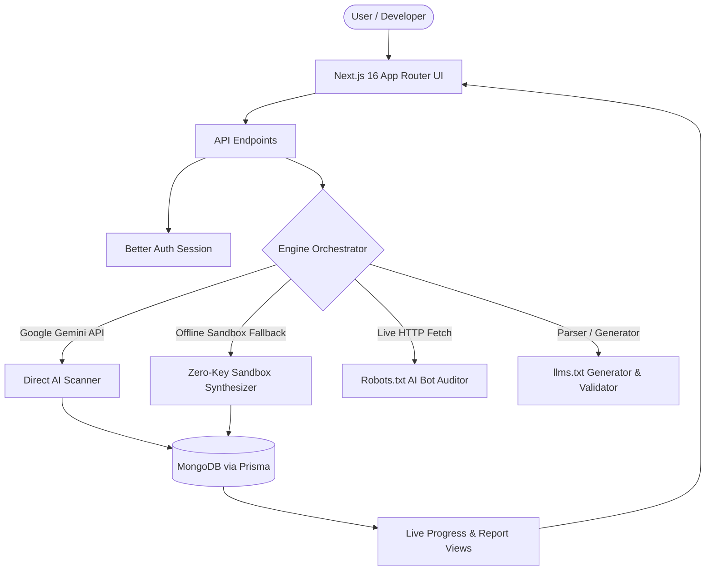

# BrandRadar 📡

> **Open-Source Generative Engine Optimization (GEO) & Answer Engine Optimization (AEO) Platform.**  
> Monitor, audit, and maximize how ChatGPT, Perplexity, and Google Gemini cite and rank your brand.

<div align="center">

[](https://opensource.org/licenses/MIT)
[](https://nextjs.org/)
[](https://tailwindcss.com/)
[](#)
[](https://github.com/topics/brand-visibility)

</div>

---

## 💡 Why BrandRadar?

Traditional SEO tracks **ten blue links on a Google search results page**.  
In 2026, over 40% of buying decisions and technical evaluations happen inside **AI Answer Engines**:
- **ChatGPT & SearchGPT**
- **Perplexity AI**
- **Google Gemini & AI Overviews**
- **Claude Sonnet & Cursor AI**

When potential customers ask an AI: *"What are the best platforms for X?"* or *"How does YourBrand compare to Competitor?"*, **does the AI mention you? Does it cite your documentation, or are your competitors dominating the narrative?**

**BrandRadar** gives you complete visibility into your generative engine presence with actionable playbooks, zero paywalls, and zero-friction setup.

---

## ✨ Key Superpowers

### 1. 🤖 AI Search Visibility Audit
- Run neutral, multi-intent prompt queries across **ChatGPT** and **Google Gemini**.
- Track your **Brand Mention Rate**, **Direct Citation Share**, and **Competitor Share of Voice**.
- Pinpoint the exact questions where competitors are recommended over your product.

### 2. ⚡ Zero-Key Demo Sandbox Mode
- **No API keys needed to test drive.** Anyone cloning the repository can click sample presets (**Supabase**, **Next.js**, **Linear**) to experience full live scanning and analytics out of the box.
- Seamlessly connect your free **Google Gemini API Key** (`gemini-2.5-flash`) whenever you want live custom scans.

### 3. 📄 Interactive `/llms.txt` Generator & Validator
- Generate compliant `/llms.txt` and `/llms-full.txt` files (the emerging open web standard for LLM ingestion).
- Live token-density estimator and one-click export to clipboard or `.txt` file.
- Built-in **Live Validator**: Audit whether any live domain properly serves `/llms.txt` with correct Markdown syntax.

### 4. 🛡️ AI Crawler & Robots.txt Auditor
- Audit your public `robots.txt` against major AI search bots:
  - `GPTBot` (OpenAI / SearchGPT)
  - `ClaudeBot` (Anthropic / Claude)
  - `PerplexityBot` (Perplexity AI)
  - `Google-Extended` (Gemini & AI Overviews)
  - `Applebot-Extended` (Apple Intelligence)
- Detect accidental wildcard blocks (`User-agent: * Disallow: /`) and copy AEO-optimized `robots.txt` snippets in 1 click.

### 5. 📋 Actionable Schema Playbook
- Auto-generates structured **Schema.org (`SoftwareApplication` / `Organization`)** JSON-LD markup based on scan findings.
- Copy-paste into your site's `<head>` to immediately boost entity authority in AI knowledge graphs.

### 6. 🎨 Clean, Fast Next.js Interface
- Full-featured dashboard with top navigation bar, responsive layout, dark/light mode, and real-time progress polling.
- Zero paywalls or credit card requirements — 100% unlocked community edition.

---

## 🏗️ Architecture



---

## ⚡ Quickstart in 60 Seconds

BrandRadar is 100% free and open source. You do **not** need a paid corporate account or Stripe billing keys to run it.

### 1. Clone the repository
```bash
git clone https://github.com/rishu685/BrandRadar.git
cd BrandRadar
```

### 2. Install dependencies
```bash
npm install
```

### 3. Setup environment variables
```bash
cp .env.example .env
```
*(Your `.env` comes pre-configured for local testing. If you want live custom AI scans, add your free Google Gemini API key).*

### 4. Initialize Database & Run
```bash
npx prisma generate
npm run dev
```

Open [http://localhost:3000](http://localhost:3000) and launch your first scan!

---

## 🏷️ Embed Your BrandRadar Badge

Showcase your generative engine visibility score on your project's GitHub README:

```markdown
[](https://github.com/rishu685/BrandRadar)
```

Result:  
[](#)

---

## 🗺️ Roadmap

- [x] Remove Stripe & unlock 100% free unlimited scans
- [x] Direct Google Gemini (`gemini-2.5-flash`) free tier integration
- [x] Zero-Key Demo Sandbox Mode for instant evaluation
- [x] Interactive `/llms.txt` Generator & Validator
- [x] AI Crawler Robots.txt Auditor
- [x] Actionable Schema.org (JSON-LD) GEO Playbook
- [x] Modern, clean, full-width responsive dashboard
- [ ] Automated weekly AI visibility email alerts
- [ ] Perplexity & DeepSeek citation verification engine
- [ ] Chrome Extension for 1-click on-page GEO audits

---

## 🤝 Contributing

Contributions, feedback, and feature requests are welcome!  
Feel free to open an [Issue](https://github.com/rishu685/BrandRadar/issues) or submit a Pull Request.

1. Fork the Project
2. Create your Feature Branch (`git checkout -b feature/AmazingFeature`)
3. Commit your Changes (`git commit -m 'Add some AmazingFeature'`)
4. Push to the Branch (`git push origin feature/AmazingFeature`)
5. Open a Pull Request

---

## 📄 License

Distributed under the MIT License. See `LICENSE` for more information.

---

<div align="center">
  <sub>Built with ❤️ for the open-source community by <a href="https://portfolio-v1-0-pi.vercel.app/">Rishabh Mishra</a>.</sub>
</div>
